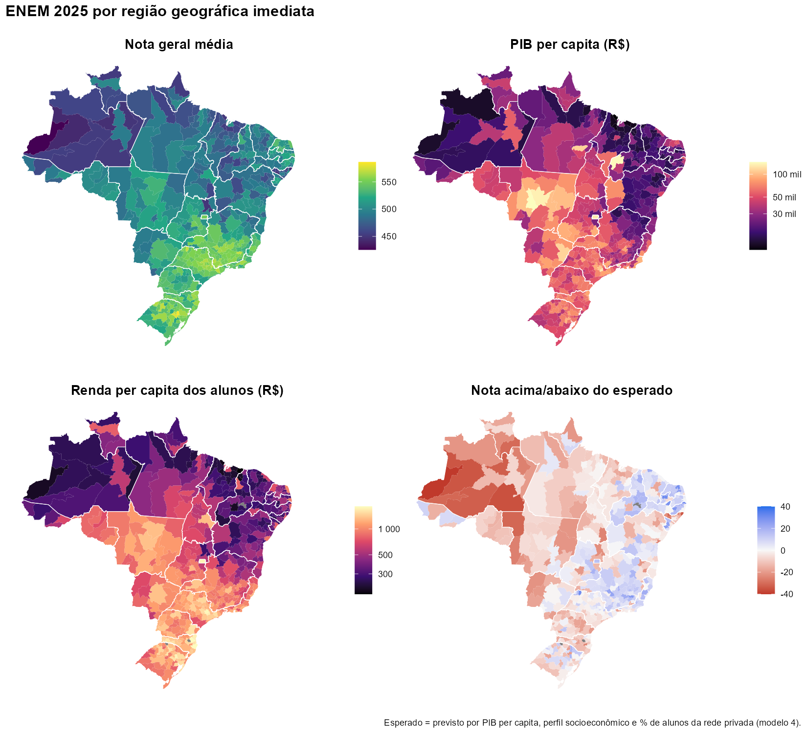

# ENEM 2025: desigualdade por rede de ensino, perfil socioeconômico e PIB regional

Cruzamento dos **microdados do ENEM 2025 (INEP)** com o **PIB dos municípios e
a população (IBGE)** nas 510 regiões geográficas imediatas do Brasil.

📊 **[Leia o relatório completo](https://moisescsantos.github.io/ENEM-2025-Desigualdade-Projeto/)** ·
📄 [versão em PDF](relatorio/relatorio_enem_2025.pdf)



## Principais resultados
- Entre os concluintes de 2025, a nota geral média da rede **privada (610)** é
  **113 pontos** maior que a da **estadual (497)**. A rede **federal (584)**
  fica perto da privada.
- O **PIB per capita** explica **55%** da variação das notas entre regiões. O
  **perfil socioeconômico dos alunos** explica **86%**. Com o perfil no
  modelo, o PIB acrescenta pouco (R² vai a 88%).
- A **vantagem da rede privada encolhe** nas regiões mais ricas: dobrar o PIB
  per capita está associado a uma diferença 8 pontos menor.
- Regiões do **interior do Nordeste** (Sousa e Pombal/PB, Afogados da
  Ingazeira/PE, Lagarto/SE) têm notas **acima do esperado** para o seu perfil.
  O **interior do Amazonas** fica abaixo.
- **Além da média:** a renda média da região explica melhor as notas dos
  alunos de nota baixa (p10, R² 0,81) do que as de nota alta (p90, R² 0,68).
  A inclinação, porém, não difere significativamente entre os dois grupos.
- **Escolaridade da mãe:** entre regiões, ela é quase inseparável da renda
  (correlação de 0,91). Com os dados de 2025 não é possível afirmar que
  pese mais que a renda.

## O desafio metodológico
Por causa da LGPD, os arquivos de participantes (perfil) e de resultados
(notas) do INEP **não têm chave em comum**. A solução foi usar o
**território como ponte**: cada base é agregada por região imediata e depois
cruzada com o IBGE. É uma **análise ecológica**: as relações valem entre
regiões, não entre indivíduos.

## Métodos e ferramentas
R · **duckdb + Parquet** (4,8 milhões de registros, 2,6 GB de CSV, lidos em
18 segundos) · tidyverse · fixest (regressões ponderadas, efeitos fixos, EP
agrupados) · sf + geobr (mapas) · R Markdown · API SIDRA e de Localidades do
IBGE.

## Estrutura
```
R/01_ibge.R            municípios → regiões imediatas, PIB 2023, população 2022, malhas
R/02_enem_parquet.R    converte os CSV do INEP para Parquet (só as colunas usadas)
R/03_agregar.R         agrega notas (por escola) e perfil (por local de prova)
R/04_analise.R         base regional, modelos, resíduos, diferença privada x estadual
R/05_figuras.R         mapas e gráficos
R/06_quantis_mae.R     quantis regionais (p10–p90) e escolaridade da mãe x renda
R/07_relatorio.R       gera o relatório em HTML, Word e PDF
R/00_referencia_word.R estilos do Word (texto justificado, linhas cinza nas tabelas)
relatorio/             relatório (R Markdown → HTML, Word e PDF)
dados/brutos/ibge/     respostas das APIs do IBGE
resultados/            figuras e tabelas
executar_tudo.R        roda tudo
```

## Como reproduzir
1. Baixe os [microdados do ENEM 2025](https://www.gov.br/inep/pt-br/acesso-a-informacao/dados-abertos/microdados/enem)
   e descompacte. Os arquivos não estão no repositório.
2. Defina a pasta `DADOS`:
   `Sys.setenv(ENEM_2025_DADOS = ".../microdados_enem_2025/DADOS")`.
3. Abra `projeto-enem-2025.Rproj` no RStudio e rode `executar_tudo.R`.

## Fontes
INEP, Microdados do Enem 2025 · IBGE, PIB dos Municípios 2023 (SIDRA 5938),
Censo Demográfico 2022 (SIDRA 4709), API de Localidades · IPEA, pacote `geobr`.
